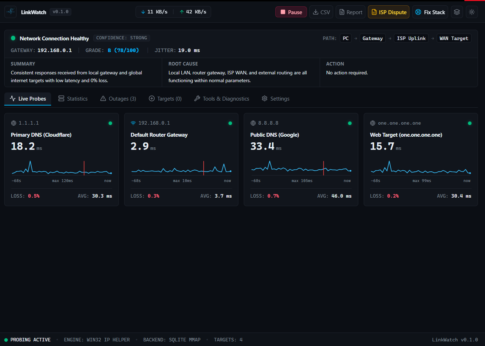
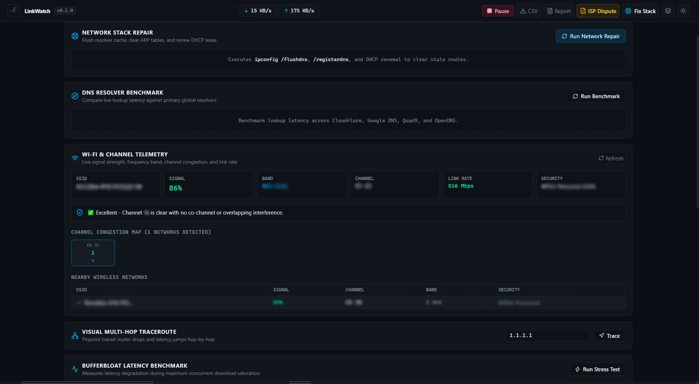
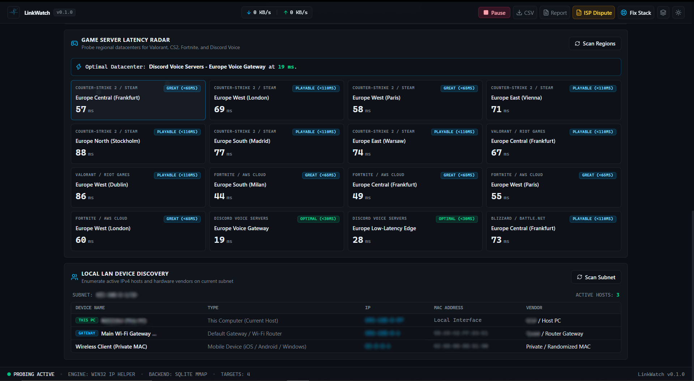

# LinkWatch

Local-first network quality and diagnostics monitor for Windows 10 and later.

LinkWatch pings your gateway and internet targets on a configurable interval, charts latency and jitter over time, detects outages, and provides diagnostic tools — traceroute, DNS comparison, bufferbloat testing, LAN scan — from one tray-resident window. No telemetry, no accounts: probe history never leaves your machine. Monitoring and most diagnostics run without admin rights; the DNS re-registration, DHCP renewal, and ARP-table clear stages of network repair require an elevated run.

## Features

**Monitoring**
- Continuous ICMP latency/jitter/packet-loss probing of gateway and internet targets, with parallel probes and cached DNS resolution
- Configurable probe interval and custom targets (edit, enable/disable, delete via the UI or IPC commands)
- Rolling history stored in SQLite, automatic data retention, CSV export
- Outage and degradation alerts with optional audio chimes and a desktop notification
- Wi-Fi link diagnostics: interface info, signal quality, nearby-network scan, channel congestion
- Bufferbloat / QoS load testing on demand: downloads up to ~100 MB from speed.cloudflare.com over plain HTTP while pinging 1.1.1.1, runs only when you start it, and uploads nothing from your machine
- Throughput: system-wide download/upload rates from network adapter counters

**Diagnostics**
- Traceroute with hop latency and loss visualization
- DNS server benchmark and comparison — sends UDP/53 queries to public resolvers (Cloudflare, Google, Quad9, OpenDNS, AdGuard)
- LAN scanner for nearby hosts
- Game server radar: pings a fixed list of regional endpoints for CS2/Steam, Valorant, Discord, and Battle.net, plus AWS cloud regions, and reports the lowest-latency region
- Gateway diagnostics: resolves the active default gateway's IPv4 address directly from the Windows routing table
- 1-click network repair (DNS cache flush, DNS re-registration, DHCP lease renewal, ARP-table clear); the last three stages require an elevated run

**Interface**
- System tray presence with a live tooltip summary
- Floating always-on-top mini-HUD with configurable position
- Custom global hotkeys
- Windows autostart (with optional minimized launch)
- Theme support and dark/light styling

## What it looks like

**Live dashboard** — per-target latency, jitter, and packet-loss with rolling sparkline charts, a confidence verdict, and summary / root cause / action panels.



**Floating mini-HUD** — an always-on-top, click-through overlay with ping, jitter, loss, health grade, and throughput, visible over any window or borderless game.


**Tools & diagnostics** — one-click network repair, DNS resolver benchmark, Wi-Fi and channel congestion telemetry, traceroute, and bufferbloat stress testing.



**Game server radar & LAN scan** — pings regional endpoints for CS2/Steam, Valorant, Discord, and Battle.net (plus AWS cloud regions) to find your best region, and enumerates active hosts on your subnet.



## Tech stack

- **Tauri 2** + Rust — core monitoring engine, tray, storage
- **React 19** + TypeScript — UI
- **Tailwind CSS 4** — styling
- **SQLite** — persisted probe history, outages, targets, settings

## Prerequisites

- Windows 10 or later
- [Rust toolchain](https://www.rust-lang.org/tools/install) 1.90 or newer, with the MSVC ABI and Visual Studio Build Tools (Tauri's Windows prerequisite)
- [Node.js](https://nodejs.org) 20.19+ or 22.12+ (Vite 8's supported range) and npm
- Microsoft Edge WebView2 Runtime (preinstalled on recent Windows 10/11 builds)

## Download

Prebuilt installers are published on the [Releases](https://github.com/MeedAli1/LinkWatch/releases) page — `LinkWatch_<version>_x64_en-US.msi` (Windows Installer) or `LinkWatch_<version>_x64-setup.exe` (NSIS setup). Unsigned builds show a Windows SmartScreen warning; choose "More info → Run anyway".

Or build from source below.

## Getting started

```bash
# 1. Install JS dependencies
npm install

# 2. Run in development mode (hot reload)
npm run tauri dev

# 3. Build a release executable
npm run tauri build
```

The release binary lands in `src-tauri/target/release/linkwatchapp.exe`.

## Commands

| Command | Description |
| --- | --- |
| `npm run dev` | Frontend dev server only (Vite, no native shell) |
| `npm run tauri dev` | Full app in development mode |
| `npm run build` | Type-check (`tsc`) and build the frontend bundle |
| `npm run tauri build` | Build the distributable native app |
| `cd src-tauri && cargo test` | Run the Rust unit-test suite |
| `cd src-tauri && cargo test --lib -- --ignored --nocapture` | Run the live-probe network tests |
| `cd src-tauri && cargo fmt` | Format Rust code |
| `cd src-tauri && cargo clippy` | Lint Rust code |

## Configuration

All app state lives in `%LOCALAPPDATA%\LinkWatch\`. A SQLite database holds probe history, outages, custom targets, and settings; two small JSON files hold UI state:

| File | Purpose |
| --- | --- |
| `linkwatch.db` | SQLite database (probe history, outages, targets, settings) |
| `hotkeys.json` | Global hotkey bindings |
| `overlay_config.json` | Mini-HUD position and state |

Default hotkeys (remappable):

| Action | Default |
| --- | --- |
| Toggle main window | `Ctrl+Shift+L` |
| Toggle mini-HUD | `Ctrl+Shift+M` |
| Network repair | unbound |
| Open diagnostics | unbound |

Accelerators use the Tauri global-shortcut format (e.g. `CmdOrCtrl+Shift+L`, `Alt+F9`).

There are no environment variables to configure for normal use.

## Architecture

The app has three layers: an **engine** of small Rust modules, each owning one capability (`src-tauri/src/engine/`); a **service** layer that runs the probe loop, alert rules, and persistence (`src-tauri/src/service.rs`); and a **React frontend** that polls snapshots over Tauri IPC. Probe history, outages, custom targets, and settings live in a local SQLite database. Details in [docs/ARCHITECTURE.md](docs/ARCHITECTURE.md).

## Development notes

- Windows-only: `src-tauri` links Windows system libraries (`windows-sys`) and the build script embeds the app icon as a Windows resource.
- The mini-HUD opens as a separate webview window loading `index.html?overlay=1`.
- `src-tauri/tests/diagnostic_tests.rs` contains integration tests that hit live network targets, so expect environment-dependent results.
- Monitoring and most diagnostics need no admin rights. In network repair, `ipconfig /flushdns` runs unelevated, while `ipconfig /registerdns`, `ipconfig /renew`, and the ARP-table clear require an elevated run; a refused step is reported as failed rather than as success. Autostart writes only the per-user `HKCU\Software\Microsoft\Windows\CurrentVersion\Run` key, so it never needs elevation.

## Known limitations

- IPv4 only: the ICMP pinger uses `IcmpSendEcho` and no code path handles IPv6 targets. IPv6-only hostnames and IPv6 literal targets are reported as "DNS resolve failed", since resolution accepts only IPv4 addresses.
- Windows only: the engine links Windows system APIs and has no portable backend.

## Contributing

File issues in the repository tracker with the steps to reproduce and, for probe-related bugs, the relevant entry from the diagnostics panel. Fork the repository and open a pull request against `main` with a focused, single-purpose change. Before submitting, make sure `cargo fmt`, `cargo clippy`, and `cargo test` pass in `src-tauri/`, and `npm run build` passes at the repository root.

## License

MIT — see [LICENSE](LICENSE).
